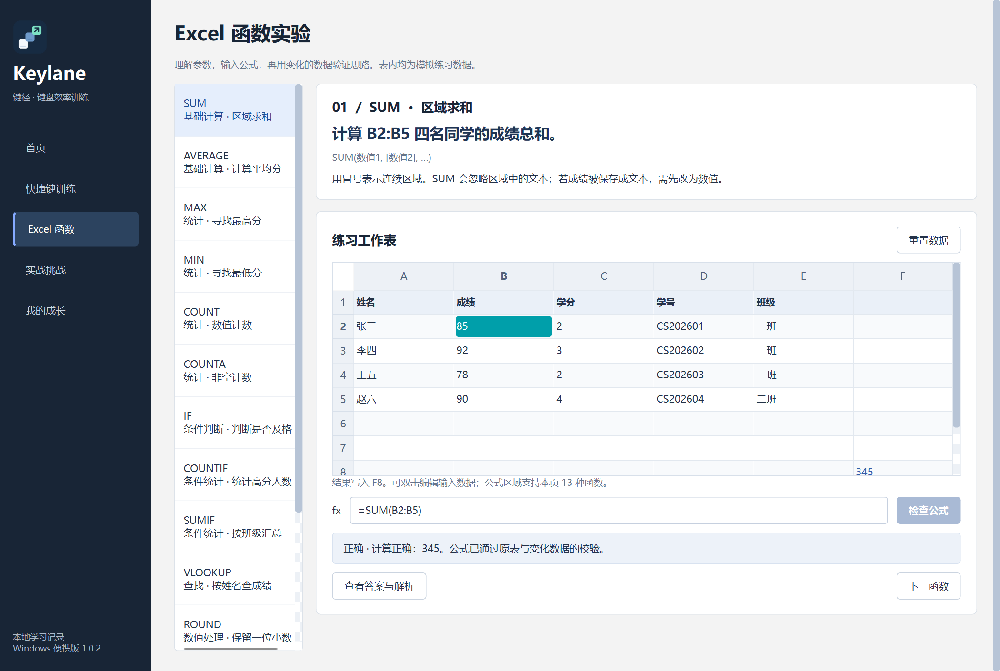

# Keylane

键盘与 Excel 操作训练。Windows 单 EXE 便携版，PySide6 + SQLite。

**[下载最新版 Windows EXE](https://github.com/alyahromagnoli-create/Keylane/releases/latest)** · [详细使用说明](docs/USER_GUIDE.zh-CN.md)

当前版本：**1.0.2**。无需安装 Python 或开发库，不要求电脑存在 D 盘。

## 功能

- 40 项 Windows / Excel 快捷键，真实按键与虚拟键盘反馈。
- 13 种基础 Excel 函数、可编辑模拟表格、公式输入与动态数据校验。
- 六步综合挑战、错题复习、技能熟练度、本地备份与 CSV 导出。
- 空格开始/暂停接收按键，答对后 Enter 下一题；Ctrl/Shift+空格仍可作答。



## 使用与数据

下载 Release 中的 `Keylane.exe`，放在可写文件夹后双击。首次解包需要几秒，解包使用 Windows 系统临时目录，程序退出后由运行时清理。

全新使用只需 EXE。保留已有记录时，先退出旧版，再把 EXE 和旁边的 **data** 文件夹一起移动或备份。持续修改的数据独立存储，不能永久写回 EXE。本仓库和下载包不包含真实个人记录。

训练在沙盒内进行，不会真的锁屏、删除外部文件或操作 Office。系统保留组合通过虚拟键盘练习。公式仅支持内置 13 种函数与有限语法，不等于完整 Excel。

## 验证范围

49 项项目测试通过；独立 EXE 在清理 Python 环境变量、限制 PATH、中文空格路径和不同工作目录下运行，并验证程序连同 data 复制到新位置后的重启与记录恢复。发布 EXE 与对应 Python 核心源码已核对。

目前仅在本机 Windows 11 x64 验证；尚未在第二台实体电脑、Windows 10 或其他架构实机验证。程序未签名。

## 从源码构建

Windows x64 + Python 3.12：

```powershell
py -3.12 -m venv .venv
.\.venv\Scripts\python.exe -m pip install -r requirements.txt
.\build.ps1
```

构建缓存和中间文件放在项目内的 work，输出路径见构建脚本。EXE 仅作为 Release 附件发布。

## 许可

原始应用与图标：**MIT**，见 [LICENSE](LICENSE)。第三方组件保留各自许可，相关原文随源码或便携包附带。
